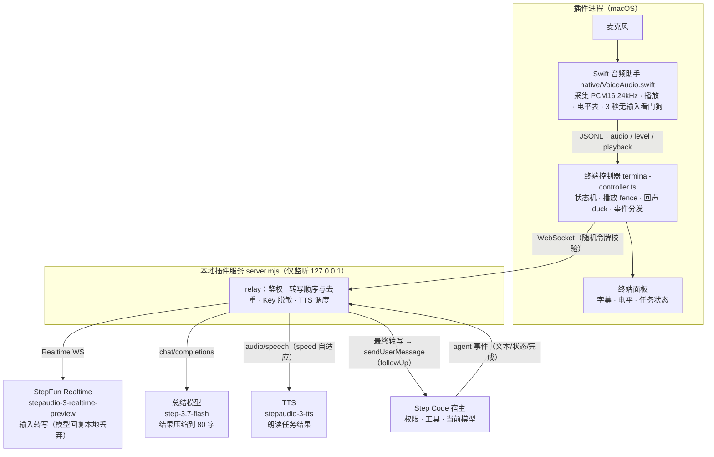

# Step Voice

[](https://platform.stepfun.com/docs/zh/api-reference/chat)

> 本插件由阶跃星辰 **Step 5 Preview** 模型驱动开发（Step Code 编码代理内完成全部设计与实现）。

> **本分支（`main`）是 macOS 版**（Swift 音频助手）。Windows 版在 `windows` 分支（C#/WinMM 音频助手），两个分支并存、互不覆盖，安装时 Windows 需加 `@windows` ref。

Step Voice 是为**当前 StepCode 会话**提供语音交互的独立插件。终端保留原语音直送；桌面正在迁移到输入栏组件接入。

**当前源码版本：0.2.0-dev.1（未发布）。** 插件端已实现实时对话 provider、任务交接和独立 TTS；桌面输入栏需要宿主实现 `stepvoice.composer/1` 契约。**当前正式 StepCode 0.2.1 尚未实现此接口，所以安装本开发版不会出现新的语音控件。**

| 运行环境 | 当前行为 |
| --- | --- |
| macOS 终端 | 原有 TUI、语音转写直送、结果朗读 |
| 正式 StepCode 桌面端 | `/stepvoice` 显示缺少输入栏接口的通知，不启动浮窗、Swift 麦克风或 relay |
| 带 Voice v1 补丁的开发宿主 | 终端可用进程内直送路径；Voice v1 不等于桌面 composer 接口 |
| 实现 composer 契约的宿主 | 注册 provider，控件/采集/播放由宿主拥有；目前只以离线契约测试验证 |

项目继续以插件交付，不修改签名 App、不注入页面、不读取宿主 cookie。旧浮窗源文件保留用于历史回归，但已退出默认桌面入口。已安装的 0.1.7 不会自动更新。

[宿主接入契约](COMPOSER_HOST_CONTRACT.md) · [架构重启方案](VOICE_ARCHITECTURE_RESTART.md)

**0.1.6 命令迁移：** 入口从 `/voice` 改为 **`/stepvoice`**，旧命令不再注册，所有子命令保留。更新插件后请重启 StepCode；仍加载 0.1.5 的进程不会自动获得新入口。

## 主要功能

- **新对话 provider（待宿主接入）**：实时音频/字幕与任务交接分开；只通过 handoff 执行任务，普通转写不再重复提交。任务进度/结果回流语音模型，打断输出不取消任务。
- **新独立 TTS（待宿主接入）**：没有麦克风或 Realtime 连接也可朗读；可取消并丢弃晚到音频，与实时对话输出互斥。
- **终端语音直送**：说话 → StepFun Realtime 转写 → 原文直接提交当前 StepCode（忙时 followUp 排队）。
- **终端结果朗读**：任务完成后生成简短摘要并流式 TTS；保留旧的字幕估算，不宣称精确逐字对齐。
- **原 Voice v1**：仍可用于本地开发宿主的终端路径，详见 [Harness 接入说明](HARNESS_INTEGRATION.md)。

终端直送模式下**停顿就是提交边界**（默认 VAD 静音阈值 450 ms）。新对话模式下转写只做展示/上下文，任务以 handoff 接收回执为准。取消任务和权限确认始终使用 StepCode 原有机制。

## 快速开始：先确认宿主能力

需要 Node.js ≥ 22.19、Git、StepCode；仅终端原生音频需要 Xcode Command Line Tools。

```bash
# 此命令安装远端版本，不包含尚未发布的本地开发改动
step install git:github.com/Zgh332358/StepFun-Voice
```

- **当前正式桌面**：新开发版只给出接口缺失通知，不建议为试浮窗而覆盖旧安装。已有内置听写按钮与本插件独立。
- **宿主维护方**：按照 [composer 契约](COMPOSER_HOST_CONTRACT.md) 实现输入栏挂载、页面采播、任务接收与事件回流，再接入插件 provider。
- **终端用户**：运行 `step` 后用 `/stepvoice setup` 配置接入，再明确开始语音。设置验证可能消耗额度，不要把 Key 发到聊天里。

先用 `step list` 确认安装来源，不要叠加同 ID 插件。插件文件更新后需要宿主重载/重启，但重启不会凭空增加宿主缺失的能力。

[桌面使用说明](FORMAL_DESKTOP.md) · [安装与启动](#安装与启动) · [环境变量](#环境变量与-stepfun-模型) · [排障](#排障指南) · [测试与验证范围](#测试与验证范围)

## 技术路径

终端支持 `ctx.voice.protocolVersion === 1` 时，控制器使用进程内 transport；否则保留终端本地 relay。桌面只探测独立的 `ctx.voiceComposer`，不把 Voice v1 当成页面音频接口。

新桌面路径：宿主输入栏/页面音频 → composer 契约 → `conversationProvider` → StepFun Realtime；任务通过宿主 `requestTask` 接收，进度通过 `updateTask` 回流。独立朗读走 `provider.speak`，不打开麦克风。宿主实现部分尚未交付，详见 [接入契约](COMPOSER_HOST_CONTRACT.md)。

下图是**保留的终端直送路径**，不是当前桌面实现：



播报链路（任务完成后触发）：宿主输出 → LLM 总结（失败自动回退为结尾 100 字截断）→ 面板立即显示将朗读的全文字幕 → TTS 合成（超标准时长自动提速，最高 2 倍）→ 本地播放，字幕高亮按收到的音频字节数和估算语速推进，可能领先实际播放。播放期间麦克风自动静音防止外放回声循环；`STEP_VOICE_ECHO_CANCEL=1` 时保持麦克风开启以支持语音打断。

### 模块职责

| 文件 | 职责 |
| --- | --- |
| `index.ts` | 能力探测、宿主 provider 注册、`/stepvoice` 终端/桌面兼容入口与资源回收 |
| `src/harness-provider.mjs` | 新宿主模式：StepFun 协议、接入配置、摘要和 TTS，无任务执行入口 |
| `src/harness-transport.mjs` | 新宿主模式：进程内 UI 适配，不重复提交最终转写 |
| `src/terminal-ui.ts` | 终端面板：字幕、电平表、任务预览、按键处理 |
| `src/terminal-controller.ts` | 语音控制器：状态机、音频适配器、播放 fence、回声 duck、事件分发、TTS 朗读字幕时钟 |
| `src/server.mjs` | 本地 relay（仅 127.0.0.1）：鉴权、转写顺序/去重、TTS 朗读与总结调度 |
| `src/stepfun.mjs` | StepFun 客户端：Realtime WS 协议、`synthesizeSpeech`、`summarizeForSpeech`、事件归一化 |
| `src/composer-contract.ts` | 待宿主实现的输入栏契约、类型与能力探测；不是正式版现有 API |
| `src/conversation-provider.mjs` | 实时对话、handoff admission/去重、任务进度回流、输出打断 |
| `src/readout-service.mjs` | 不依赖麦克风和 Realtime 连接的独立摘要/TTS、取消与输出 fencing |
| `src/native-hud.mjs` / `native/VoiceHUD.swift` | 旧版浮窗代码，仅保留历史回归；不被新桌面入口调用 |
| `src/native-audio.mjs` | 音频助手生命周期：按源码摘要本地编译 Swift 二进制、JSONL IPC |
| `native/VoiceAudio.swift` | macOS 采集/播放/电平/看门狗（AVAudioEngine，编译时内嵌 Info.plist） |
| `src/bridge.ts` | 宿主桥接：`sendUserMessage`、agent 事件快照 |
| `src/transcription-queue.mjs` | 转写乱序/超时/去重队列 |
| `src/credentials.mjs` | Key 保存与校验（目录 700 / 文件 600） |
| `src/audio.mjs` | 播放 fence 等音频工具类 |
| `src/types.ts` | 共享类型 |

## 安装与启动

当前原生音频支持 **macOS**，需要 Node.js **22.19 或更高版本**、已安装的 Step Code 和 **Xcode Command Line Tools**。从源码启动 Step Code 还需要 pnpm **9**。首次开始语音时会编译音频助手；缺少编译工具时，按系统提示运行 `xcode-select --install` 安装。

### 从 GitHub 安装

GitHub 托管插件源码和版本，不需要 npm 账号。插件仓库为 [Zgh332358/StepFun-Voice](https://github.com/Zgh332358/StepFun-Voice)，根目录直接包含 `package.json`、`index.ts`、`src/` 和 `native/`。详见 [GitHub 分发说明](GITHUB.md)。

在要使用语音的项目目录执行：

```bash
step install -l git:github.com/Zgh332358/StepFun-Voice
step
```

然后输入 `/stepvoice`。桌面用户按上面的快速开始操作；以下快捷键说明适用于终端 TUI 的首次接入：

1. 选择接入通道：**开放平台 API**（按调用量计费）或 **Step Plan**（使用订阅套餐额度）。
2. 粘贴 API Key（输入时只显示最后 4 位）。两个通道用同一把平台 Key，在 [platform.stepfun.com/interface-key](https://platform.stepfun.com/interface-key) 创建；Step Plan 通道需要账号已[订阅套餐](https://platform.stepfun.com/step-plan)。
3. 插件当场验证：先确认 Key 被该通道接受，再确认该通道的实时语音模型能建立会话。通过后保存，按 Enter 开始语音。

如果启动前已经 `export STEP_API_KEY`，第 2 步直接按 Enter 就会使用它，不会另存一份。之后可在面板按 Ctrl+O → K 更换通道或 Key，或运行 `/stepvoice setup`。Step Code 会 clone 仓库、安装运行依赖并注册扩展。安装仅注册插件，麦克风在用户明确开始语音后启用。

### 两个接入通道

| | 开放平台 API | Step Plan |
| --- | --- | --- |
| API 地址 | `https://api.stepfun.com/v1` | `https://api.stepfun.com/step_plan/v1` |
| 实时语音模型 | `stepaudio-3-realtime-preview` | `stepaudio-2.5-realtime` |
| 结果朗读模型 | `stepaudio-3-tts` | `stepaudio-2.5-tts` |
| 计费 | 按调用量 | 折算为 Step Plan 套餐额度 |

2026-10-12 用同一把 Key 实测：Step Plan 路径不提供 `stepaudio-3-*` 模型（返回 404），所以选择通道时插件会同时切换默认模型。

### 默认模型与修改配置

不设置模型和音色环境变量时，插件使用所选通道的默认值（下表为开放平台通道）：

| 配置项 | 默认值 | 环境变量 |
| --- | --- | --- |
| Realtime 输入转写 | `stepaudio-3-realtime-preview` | `STEP_VOICE_REALTIME_MODEL` |
| 任务结果朗读（TTS） | `stepaudio-3-tts` | `STEP_VOICE_TTS_MODEL` |
| 结果总结（文本模型） | `step-3.7-flash` | `STEP_VOICE_SUMMARY_MODEL` |
| 语音音色 | `linjiajiejie` | `STEP_VOICE_VOICE` |

要覆盖默认模型或音色，用 `export STEP_VOICE_REALTIME_MODEL=...` 等变量设置你 StepFun 账号可用的模型或音色，再从**同一个终端**运行 `step`。如果 Step Code 已经运行，先退出，再设置变量并重新启动；在另一个终端执行 `export` 不会更新已有进程。启动后用 `/stepvoice config`，或在语音面板按 Ctrl+O，查看当前配置。

编码与文件、终端任务沿用 **Step Code 当前选择的模型**，不由这些语音变量指定。代码还提供默认型号为 `stepaudio-3-asr-max` 的独立 ASR helper，可通过 `STEP_VOICE_ASR_MODEL` 修改；当前通话的理解和字幕由 Realtime 完成，不使用这个独立 ASR 路径。

### 管理安装

不带 `-l` 时安装到用户范围，可用于其他项目。当前项目引用保存在 `.stepcode/config.toml`；用户引用保存在 `~/.stepcode/config.toml`，由 Step Code 管理。安装后需要**退出并重新启动 StepCode**；已打开的会话不会热更新扩展代码。查看、更新和卸载：

```bash
step list
# 更新已安装的 Git 扩展：再次安装同一来源，宿主会 fetch 并快进该 clone
step install git:github.com/Zgh332358/StepFun-Voice
step remove git:github.com/Zgh332358/StepFun-Voice
# 若原来使用 -l 安装，卸载也添加 -l
```

**不要用 `step update <扩展来源>` 更新扩展。** 在 StepCode 0.2.1 中，`step update` 只处理 Step 自身版本，形如 `step update [version]`；传入仓库地址会得到用法错误，而不会更新插件。若该版本的 `step update --extensions` 可用，也可以使用它；否则以上面的重复安装方式为准。

需要固定版本时，先确认目标 tag 或提交确实存在，再在 Git 来源后添加 `@<ref>`。`package.json` 中的版本号不等于已经创建了同名 Git tag。

**本地安装与 GitHub 安装不是同一个来源。** 如果 `step list` 显示本地目录，请保留旧目录备份后再决定是更新本地文件，还是移除该本地来源并安装 GitHub 来源；不要直接叠加两份 Step Voice。更新前先结束通话，更新后重启正式桌面应用。

本插件没有 npm 发布配置、scope 设置或 npx 安装器；`package.json` 标记为 `private`。依赖安装仍由 Step Code 的 Node package 工具处理，这是插件运行需要的 `ws` 依赖。无需在 npm 注册或发布插件。

### 从本仓库源码启动

本仓库是独立插件，不包含 StepCode 的 monorepo、`plugins/step-voice` 目录或 pnpm 锁文件。使用已安装的 `step` 命令：

```bash
git clone https://github.com/Zgh332358/StepFun-Voice.git
cd StepFun-Voice
npm ci --ignore-scripts

# 仅在这个开发进程显式加载本地插件，避免重复加载已安装副本
step --no-extensions -e ./index.ts
```

进入终端后运行 `/stepvoice setup` 配置接入，再用 `/stepvoice` 打开面板。输入框为空时按 Enter 才开始语音；也可运行 `/stepvoice start`。不要在命令消息中传入 Key。

需要让正式桌面版加载这个源码目录时，先确认没有重复安装，再执行 `step install /absolute/path/to/StepFun-Voice`，随后重启桌面应用。

仓库内的 `启动 Step Voice.command` 也是终端启动辅助入口，不是桌面面板安装器。

### 项目级安装

在目标项目中执行：

```bash
step install -l /absolute/path/to/StepFun-Voice
```

`-l` 将插件限定在当前项目。插件通过 `package.json` 中 `pi.extensions` 的 `./index.ts` 加载；`step.plugin.json` 记录插件身份，不会自动修改宿主程序。

### 本地运行包

```bash
npm ci --ignore-scripts
node scripts/package-plugin.mjs
```

脚本在 `.cache/releases/` 生成 `step-voice-<版本>-macos.zip`，只打包运行代码、文档和锁定版本的 `ws`；不包含测试数据、账号、录音和凭证。它是本地构建产物，不代表 GitHub 已创建 Release 或上传附件。

`scripts/install-local-plugin.mjs` 仅用于备份并替换**已经存在且已注册**的 `~/.stepcode/local-packages/step-voice` 本地安装。它不修改加载配置、凭证或 `StepCode.app`；普通 GitHub 安装用户不需要运行这个维护脚本。

## macOS 桌面端

桌面插件保持独立安装/卸载，不修改 StepCode.app。当前开发版仅接入 `stepvoice.composer/1` 提案，类型与说明见 [COMPOSER_HOST_CONTRACT.md](COMPOSER_HOST_CONTRACT.md)。

### 当前正式宿主的实际行为

- `/stepvoice`、`panel`、`start`、`setup` 等只通知“宿主未提供输入栏语音插件接口”。不启动 HUD、原生麦克风或 localhost relay。
- `/stepvoice config` 说明接入前提；`stop` 清理已有插件资源。
- 这不是麦克风权限错误，不应让用户反复去系统设置找开关；重启或重装也不会补齐该接口。

### 宿主完成契约后的行为

1. provider 在 session_start 注册，主页面挂载输入栏入口；`/stepvoice` 只展开，不录音。
2. 用户开始后，宿主负责页面采集和播放器，插件负责 StepFun 连接和事件适配。
3. 普通字幕不提交任务；只有经过校验的 handoff 通过宿主 admission 接口提交一次。
4. `mute`、`interrupt`、`end` 分别控制输入、语音输出和通话；停止编码任务仍用原宿主机制。
5. `setup` 由宿主安全输入组件调用配置接口，Key 不进入聊天或模型上下文；更新/清除配置前必须结束对话/朗读。
6. 独立 `provider.speak` 可在麦克风关闭时朗读，不与实时对话音频同时播放。

### 验证边界

输入栏挂载、浏览器设备采播、同源媒体桥、真实 admission adapter 尚未由正式宿主实现。离线契约测试验证的是插件行为，不是最终页面、中文输入法或真人语音效果。

历史 `npm run test:hud` 只测试旧浮窗，不是新架构的验收；主要使用完整离线回归、正式宿主能力缺失分支测试，以及未来宿主接入后的真机测试。

## 终端操作

| 命令 | 用途 |
| --- | --- |
| `/stepvoice` / `/stepvoice panel` | 打开语音面板；后台 Agent 工作时显示终端语音状态控件 |
| `/stepvoice start` | 开始语音，申请本机麦克风访问 |
| `/stepvoice mute` | 切换麦克风静音 |
| `/stepvoice interrupt` | 清空本地播放队列（含打断朗读）；不取消上游转写，也不停止编码任务 |
| `/stepvoice end` | 结束通话并关闭麦克风，保留本地语音服务 |
| `/stepvoice stop` | 释放语音控制器与本地服务 |
| `/stepvoice status` | 查看语音和宿主任务状态 |
| `/stepvoice setup` | 打开接入引导：选择通道、输入并验证 API Key |
| `/stepvoice config` | 显示接入说明 |

在语音面板中：

| 按键 | 用途 |
| --- | --- |
| Enter（输入框为空） | 开始或结束当前语音 |
| 直接打字 + Enter | 直接发送给 Step Code，默认 followUp；不需要开启麦克风 |
| Tab | 仅切换文字的队列方式：后续任务 followUp / 补充当前任务 steer；语音始终 followUp |
| Ctrl+T | 切换麦克风静音 |
| Ctrl+X | 清空本地播放队列（打断正在播放的语音回复或朗读） |
| Ctrl+G | 请求停止后台 Agent 任务 |
| Ctrl+O | 接入设置：查看通道、Key 来源和模型；K 更换通道或 Key，X 清除保存的 Key |
| Ctrl+Q | 结束通话并收起面板 |
| Esc | 输入框有内容时清空；为空时收起面板，保留当前通话 |
| Ctrl+C | 收起面板，保留当前通话；终端状态控件继续显示语音状态 |

面板下方的输入框始终可用，字母和中文输入法的文字都会进入输入框。无论通话是否开启，文字都发给 Step Code；没有“发给语音模型”的模式。设置视图中的 R 重新读取**当前进程**已有的 Key、API 地址和模型变量，需先结束通话。VAD 和其他参数改动需重新启动 Step Code。

当后台编码任务开始时，完整语音面板会收起，麦克风与通话按当前状态继续运行，终端保留语音状态控件。这使宿主的权限确认和其他交互继续获得键盘焦点。可继续说话，或使用 `/stepvoice mute`、`/stepvoice interrupt`、`/stepvoice end` 控制通话；任务结束后通过 `/stepvoice` 重新打开完整面板。

## 环境变量与 StepFun 模型

Key 有两个来源：

- **面板引导里输入的 Key**：验证通过后保存在 `~/.stepcode/step-voice/credentials.json`。目录权限 700、文件权限 600，只有当前用户能读。文件里还记录所选通道。设置里按 X 可以删除。
- **环境变量** `STEP_API_KEY` / `STEPFUN_API_KEY`（同时存在时优先 `STEP_API_KEY`）。已经运行的进程不会收到另一个终端新设置的变量，设置后需要重新启动 Step Code。

两者都有时，使用面板里保存的 Key。Key 不传给原生音频助手，界面和报错里只显示最后 4 位。Step Code 的 Step Plan / OAuth 登录与 API Key 是两回事：已经登录编码工具，不代表语音 API Key 已配置。

| 环境变量 | 默认值 | 用途 |
| --- | --- | --- |
| `STEP_API_KEY` / `STEPFUN_API_KEY` | 无 | StepFun API Key（面板里保存的 Key 优先） |
| `STEP_VOICE_CHANNEL` | `api` | 未在面板选择时的通道：`api` 或 `step_plan` |
| `STEP_VOICE_BASE_URL` | 随通道 | 官方 API 地址：`/v1`（开放平台）或 `/step_plan/v1`（Step Plan），域名可为 `api.stepfun.com` / `api.stepfun.ai` |
| `STEP_VOICE_REALTIME_MODEL` | `stepaudio-3-realtime-preview` | Realtime 输入转写（回复事件默认丢弃） |
| `STEP_VOICE_TTS_MODEL` | `stepaudio-3-tts` | 任务结果朗读的 TTS 模型 |
| `STEP_VOICE_SUMMARY_MODEL` | `step-3.7-flash` | 结果总结用的文本模型，需为账号可用模型；调用失败自动回退为截断 |
| `STEP_VOICE_VOICE` | `linjiajiejie` | 语音音色 |
| `STEP_VOICE_SILENCE_MS` | `450` | VAD 停顿判定，范围 100–2000 毫秒 |
| `STEP_VOICE_VAD_THRESHOLD` | `2500` | VAD 能量阈值，范围 0–5000 |
| `STEP_VOICE_ECHO_CANCEL` | `0` | 置 `1` 启用系统回声消除；部分 macOS 上开启后麦克风无数据（见下文排查）。开启后播放期间不再自动静音麦克风，可语音打断 |
| `STEP_VOICE_SPEAK_TASKS` | 开 | 置 `0` 关闭任务完成后的 TTS 结果朗读 |
| `STEP_VOICE_SUMMARY` | 开 | 置 `0` 关闭 LLM 自动总结，改用结尾 100 字截断 |
| `STEP_VOICE_INSTRUCTIONS` | 内置语音陪伴提示 | 仅影响上游会话提示，不能开启工具委派 |
| `STEP_VOICE_ASR_MODEL` | `stepaudio-3-asr-max` | 独立 ASR helper 型号，当前通话不使用此路径 |

语音转写使用 StepFun Realtime，编码任务继续使用 Step Code 宿主当前选择的模型和配置。`src/stepfun.mjs` 同时提供 `transcribeAudio()` 独立 ASR SSE helper 和 `synthesizeSpeech()` TTS helper；当前通话的转写走 Realtime，朗读走 TTS helper。

## 语音直送与后台工作

可以直接说“帮我检查当前项目的启动问题”。服务端消费官方 `conversation.item.input_audio_transcription.completed` 的 `item_id`、`content_index` 与 `transcript`，将最终原文交给当前宿主 `sendUserMessage`，不依赖 `stepcode_task` 或意图分类。partial、模型回复文本、回复音频字幕都不会执行。

- 同一语音会话按观察到的 speech start/end/commit 顺序等待异步 final；一个 VAD 输入项的第一个终态封存该项，同一 final 重放只执行一次。同文但不同输入项分别提交。
- 每段说话最长等待 120 秒；结束/提交后转写等待 15 秒。失败、空文本、缺失索引或超长文本明确显示“未提交”，并释放后续输入。缺失输入项 ID、超过 32 段积压或 2048 个会话输入项时停止语音，不通过淘汰去重记录允许重放。
- 忙时语音始终 followUp，不自动调整当前任务。文字可以 Tab 选 steer。说“停止后台任务”也是普通后续文字；需要立即停止请按 Ctrl+G 或使用宿主取消操作。
- 结束通话或重连不会重放录音，未完成的转写被丢弃；已经提交的任务继续由宿主管理。麦克风打开后，环境里其他人的话也可能被识别成输入，请在安静且可控的环境使用。
- 需要权限确认时，插件界面先让出焦点，请在 StepCode 主界面处理；插件不会自动批准工具或绕过项目可信检查。

### 任务结果朗读

任务完成（`agent.complete` 且非错误）时自动触发：

1. 取宿主真实输出的结尾（脱敏后最多 100 字）；
2. 调用总结模型压缩为口语化摘要（模型不可用时自动回退为该截断文本，并在面板提示一次原因）；
3. 面板显示将朗读的全文字幕；高亮按收到的音频字节数估算（PCM16 24 kHz 单声道 = 48 字节/毫秒），不是播放器已播放帧数；
4. 调用 TTS 合成，语速按摘要长度自适应：80 字内原速，超长按比例提速（上限 2 倍），整段控制在播放队列 30 秒上限内；
5. 播放期间麦克风自动静音（防外放回声循环），播完恢复；`STEP_VOICE_ECHO_CANCEL=1` 时不静音，支持语音打断。

字幕在合成开始时就完整可见，高亮可能领先实际播放；尚未接入播放器进度来实现准确逐字对齐。收尾使用播放结束通知和超时兜底，不应作为精确同步的证明。`voice.interrupt` / Ctrl+X 会同时终止合成、播放与字幕。

`voice.interrupt` / Ctrl+X 会同时终止合成与播放。总结失败与播放队列溢出都只产生面板提示，不影响语音会话。

**真实输出以 StepCode 主界面为准。** 插件只展示当前宿主公开文本的有限预览，同步任务状态、完成和错误，不包含内部思考或完整工具参数。终端面板使用有限行数预览，桌面弹窗展示最近字幕/输出摘要。宿主结果不会被重新发送给 Realtime；直送模式丢弃 Realtime 模型自发的回复，结果朗读来自宿主实际输出。

## 排障指南

### `/stepvoice` 没有反应，或首次只有技能候选

1. 升级后必须**退出并重新启动 StepCode**；扩展代码不会在已打开的会话中热更新。
2. 运行 `step list`，确认已安装来源只有一份，并检查该目录 `package.json` 的 `version` 为 `0.1.6`，`index.ts` 中注册的是 `stepvoice`。仍显示 `0.1.5` 说明更新没有生效。
3. 若同时存在本地目录来源和 Git 来源，只保留一份，否则会加载两个版本的插件。
4. 桌面输入框在输入 `/step` 时仍可能显示技能列表，这只是候选区；要继续输入完整 `/stepvoice` 并按 Enter，插件命令才会被宿主分发。

### 麦克风电平表恒为 0%

部分 macOS 上启用系统回声消除（VPIO）后，麦克风输入回调完全停止，且同一进程内无法恢复，表现为面板“正在聆听”但电平表恒为 0%、永远没有转写。因此现在**默认使用普通采集、不启用回声消除**；默认朗读走 TTS 且播放期间麦克风已自动静音，通常无需回声消除，外放时建议戴耳机。确需系统回声消除（开启 `STEP_VOICE_ECHO_CANCEL=1` 后佩戴耳机），可语音打断播放。

音频助手内置 3 秒无输入看门狗：采集被系统饿死时会在面板显示提示。诊断显示采集无数据时，到 系统设置→声音→输入 重新选择一次输入设备可恢复。

### 播放队列溢出

朗读文本超长时助手会在 30 秒播放队列满时清空队列并提示“待播放音频超过 30 秒，已清空播放队列”。这只是播放层保护，会话与采集不受影响。标准摘要长度已控制在安全范围内；若仍触发，说明上游内容异常，请把面板提示转报。

### 总结失败

总结失败时朗读自动回退为结尾 100 字截断，并在面板提示一次原因：`404`/“does not exist” 表示 `STEP_VOICE_SUMMARY_MODEL` 不是账号可用模型；`finish_reason=length` 表示思考型模型的 token 预算不足（已放大到 8000，仍出现请更换非推理文本模型）。总结失败不影响朗读，只是内容变为原文截断。

### 卡在准备或处理状态时

语音面板顶部显示实际语音阶段：“准备本地音频助手”“打开麦克风”“连接 StepFun 语音模型”，连接完成后显示“正在聆听”。下方“Step Code · 等待任务”只表示编码 Agent 当前闲置。首次使用需要编译助手；看到麦克风权限提示时，在系统提示中允许当前终端应用。

准备与打开音频有 75 秒总超时，模型就绪等待最多 25 秒。可以按 Enter 取消启动，再次 Enter 重试；旧操作与旧会话事件不会覆盖新通话。

### 修改源码后生效

修改源码不会热更新已加载模块。先用 `/stepvoice end` 结束录音，待宿主任务稳定后手动 `/reload`，或退出再启动 Step Code。Swift 助手按源码摘要自动重新编译。若同时有项目和全局安装，确认重载的是所修改的项目副本；不要执行更新命令覆盖本地变更。

宿主的 `sendUserMessage` 返回 `void`，因此“已提交 / 已排队”只表示已尝试交给宿主，不是执行成功确认。插件在 45 秒未观察到开始、且宿主没有运行任务或等待交互时，显示无启动错误；排队时继续等待当前工作/权限结束。同步提交异常会清除本次关联，**接受结果不确定时不补发、不自动重试**。请先核对主终端的用户消息、队列、模型/登录错误，再决定是否重新输入。

## 测试与验证范围

`npm test` 默认禁止外部 HTTP/TCP，只允许 loopback；遗漏 mock 会直接失败，不会请求真实语音服务。**独立运行仍需要宿主的 TUI 模块**，裸 `npm test` 在没有该依赖时会报错，不会静默跳过 UI 测试。

### 正式桌面宿主回归

```bash
# 基础回归 + 已安装正式宿主的命令分发、SelectionBroker、补全行为
STEP_CODE_TUI=/Applications/StepCode.app/Contents/Resources/server/node_modules/@step-harness/pi-tui/dist/index.js \
STEP_CODE_HOST=/Applications/StepCode.app/Contents/Resources/server/node_modules/@step-harness \
npm test

# 单独验证弹窗逻辑，不依赖 TUI 模块
node --import ./test/offline-network.mjs --test test/desktop-dialog.test.mjs

# 真正打开未修改的正式程序，在独立测试配置中检查非模态入口和显式设置
STEP_VOICE_PACKAGE="$PWD" node scripts/formal-desktop-smoke.mjs
```

桌面 UI 检查需要本机安装 StepCode 和 CLI，本次在 **0.2.1** 上验证。脚本使用临时 HOME、占位模型声明、补全冲突技能样本和网络保护，不使用真实账号，也不申请麦克风权限。默认程序位置是 `/Applications/StepCode.app`，可用 `STEP_CODE_APP`、`STEP_CODE_CLI` 指定其他位置。它会打开并关闭一个独立测试窗口，不重启你的工作窗口。

如果宿主包没有附带 Playwright（例如 0.2.1），仅测试时通过 `STEP_PLAYWRIGHT_MODULE=/absolute/path/to/playwright-core/index.mjs` 指向已安装的测试驱动；插件正常使用不需要 Playwright。

### 可选 Voice v1 开发宿主验证

```bash
# 需要已经打过 Voice v1 补丁、安装依赖并构建的独立宿主源码
STEP_CODE_SOURCE=/path/to/patched-Step-Code \
STEP_CODE_VOICE_SOURCE=/path/to/patched-Step-Code npm test

STEP_CODE_VOICE_SOURCE=/path/to/patched-Step-Code npm run check:types
```

未设置 `STEP_CODE_VOICE_SOURCE` 时，3 项新宿主构建产物测试明确跳过；未设置 `STEP_CODE_HOST` 时，2 项正式桌面宿主测试明确跳过。这些条件不能与“全部通过”混为一谈。Voice v1 补丁不包含在普通插件安装中，详见 [Harness 接入说明](HARNESS_INTEGRATION.md)。

### 0.1.6 验证记录（2026-11-01）

| 检查 | 结果与前提 |
| --- | --- |
| 完整自动化套件 | **175 通过、0 失败、0 跳过**；同时提供正式桌面模块与配套 Voice v1 源码 |
| 当前源码的正式宿主检查 | **2 项通过**；真实发现/加载、命令分发、选择 broker 与前端补全 |
| 未修改的正式桌面程序 UI 检查 | **6 项通过**；先观察旧技能候选，再实际发送裸 `/stepvoice` 并查看弹窗截图 |
| TypeScript | 配套宿主公开类型下通过 |
| Swift `--self-test` | 离线 PCM 转换通过，`permissionRequested: false`；不测试真实录音 |

核心覆盖包括转写直送、去重和乱序、超时、旧会话隔离、任务状态、文字队列、摘要/TTS 回退、播放中静音、启动取消和资源清理。截图、测试日志、运行 ZIP 和安装回执写入本地 `.cache/` 或临时目录，不随源码上传。

**真人语音尚需单独验收。** 由你主动配置 Key 并授权麦克风后，说一句无副作用请求，核对一次转写、一次宿主提交、真实输出与朗读。不要把模拟模型或隔离常驻面板的测试结果当作正式版真人语音已验收。

## 边界与限制

- 本 `main` 分支只提供 macOS 原生音频；Windows 版本位于独立 `windows` 分支，本次 0.1.6 桌面兼容改动未同步到该分支。Linux 不在本次支持范围。
- 实际延迟、中文识别、音色效果、扬声器回声表现，需要在配置 Key 的 macOS 设备上验证。VAD 由 StepFun 服务端判定，网络延迟与录音环境会影响打断速度。
- 总结模型 `step-3.7-flash` 为思考型模型，朗读前有几秒总结延迟；若账号无此模型，朗读自动回退为结尾截断并在面板提示。
- 国内和海外 API 的账号、Key、模型可用性需要分别核实，插件不会自动跨地区发送 Key。服务与型号变化时，以 StepFun 当前文档为准。

如果本地控制连接失败，执行 `/stepvoice stop` 后再 `/stepvoice`，重建控制器。麦克风被拒绝时，在 macOS 系统设置中允许当前终端应用使用麦克风，再重新开始。缺少 Key 时会显示环境变量说明；Key、模型权限和接口错误在终端呈现。

## 官方资料

- [StepFun Realtime 开发指南](https://platform.stepfun.com/docs/zh/guides/developer/realtime)
- [Realtime API 事件与工具协议](https://platform.stepfun.com/docs/zh/api-reference/realtime/chat)
- [StepAudio 3 Realtime 模型介绍](https://platform.stepfun.com/docs/zh/guides/models/stepaudio-3-realtime)
- [StepFun TTS HTTP / SSE 接口](https://platform.stepfun.com/docs/zh/api-reference/audio/create-audio)
- [TTS 语速等参数 FAQ](https://platform.stepfun.com/docs/zh/guide/tts)
- [独立 ASR SSE 接口](https://platform.stepfun.com/docs/zh/api-reference/audio/asr-sse)
- [Step Code 官方仓库](https://github.com/stepfun-ai/Step-Code)
- [Step Code extension 说明](https://github.com/stepfun-ai/Step-Code/blob/main/packages/coding-agent/docs/extensions.md)
- [Step Code package 说明](https://github.com/stepfun-ai/Step-Code/blob/main/packages/coding-agent/docs/packages.md)

协议与默认型号按 2026-10 的官方资料实现。本插件遵循 [MIT License](LICENSE)。
