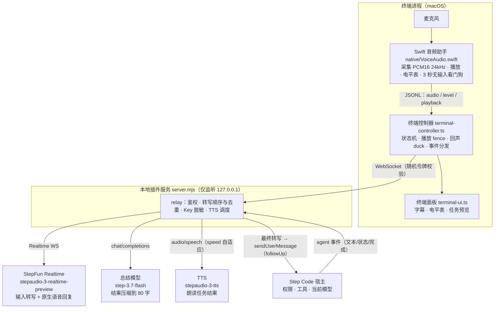

# Step Voice

[](https://platform.stepfun.com/docs/zh/api-reference/chat)

> 本插件由阶跃星辰 **Step 5 Preview** 模型驱动开发（Step Code 编码代理内完成全部设计与实现）。

> **本分支（`main`）是 macOS 版**（Swift 音频助手）。Windows 版在 `windows` 分支（C#/WinMM 音频助手），两个分支并存、互不覆盖，安装时 Windows 需加 `@windows` ref。

Step Voice 是可单独加载的 Step Code 终端语音插件，让编码代理拥有 Codex 式的语音工作流：

- **语音直送**：说话 → StepFun Realtime 转写 → 原文直接提交当前 Step Code（忙时 followUp 排队）。不经意图分类、不代替 Step Code 完成任务。
- **结果朗读**：任务完成后，自动用 LLM 把真实输出总结成 ≤80 字口语化摘要，再用 TTS 以自适应语速朗读，整段控制在播放队列安全范围内；/voice 面板同步显示字幕并随播放进度高亮。
- **原生语音回复**：Realtime 模型自己的简短语音反馈直接播放，字幕在面板以“Step”显示。
- **全程可观测**：电平表、提交/排队/错误状态、总结失败原因，全部在面板可见，没有静默失败。

**停顿就是提交边界**（默认 VAD 静音阈值 450 ms），请一次说完一条指令。需要暂停输入时用 `/voice mute`，取消编码任务用 Ctrl+G，权限确认始终在主终端处理。

## 技术路径



播报链路（任务完成后触发）：宿主输出 → LLM 总结（失败自动回退为结尾 100 字截断）→ 面板立即显示将朗读的全文字幕 → TTS 合成（超标准时长自动提速，最高 2 倍）→ 本地播放，已读字幕随播放进度高亮（音频字节时钟 × 自适应语速）。播放期间麦克风自动静音防止外放回声循环；`STEP_VOICE_ECHO_CANCEL=1` 时保持麦克风开启以支持语音打断。

### 模块职责

| 文件 | 职责 |
| --- | --- |
| `index.ts` | 插件入口：注册 `/voice` 命令与扩展生命周期 |
| `src/terminal-ui.ts` | 终端面板：字幕、电平表、任务预览、按键处理 |
| `src/terminal-controller.ts` | 语音控制器：状态机、音频适配器、播放 fence、回声 duck、事件分发、TTS 朗读字幕时钟 |
| `src/server.mjs` | 本地 relay（仅 127.0.0.1）：鉴权、转写顺序/去重、TTS 朗读与总结调度 |
| `src/stepfun.mjs` | StepFun 客户端：Realtime WS 协议、`synthesizeSpeech`、`summarizeForSpeech`、事件归一化 |
| `src/native-audio.mjs` | 音频助手生命周期：按源码摘要本地编译 Swift 二进制、JSONL IPC |
| `native/VoiceAudio.swift` | macOS 采集/播放/电平/看门狗（AVAudioEngine，编译时内嵌 Info.plist） |
| `src/bridge.ts` | 宿主桥接：`sendUserMessage`、agent 事件快照 |
| `src/transcription-queue.mjs` | 转写乱序/超时/去重队列 |
| `src/credentials.mjs` | Key 保存与校验（目录 700 / 文件 600） |
| `src/audio.mjs` | 播放 fence 等音频工具类 |
| `src/types.ts` | 共享类型 |

## 安装与启动

当前原生音频支持 **macOS**，需要 Node.js **22.19 或更高版本**、已安装的 Step Code 和 **Xcode Command Line Tools**。从源码启动 Step Code 还需要 pnpm **9**。首次开始语音时会编译音频助手；缺少编译工具时，按系统提示运行 `xcode-select --install` 安装。

### 从 GitHub 安装

GitHub 托管插件源码和版本，不需要 npm 账号。插件仓库为 [Zgh332358/StepFun-Voice](https://github.com/Zgh332358/StepFun-Voice)，根目录直接包含 `package.json`、`index.ts`、`src/` 和 `native/`。详见 [GitHub 分发说明](GITHUB.md)。

在要使用语音的项目目录执行：

```bash
step install -l git:github.com/Zgh332358/StepFun-Voice
step
```

然后输入 `/voice`。**第一次打开时面板会引导你完成接入**：

1. 选择接入通道：**开放平台 API**（按调用量计费）或 **Step Plan**（使用订阅套餐额度）。
2. 粘贴 API Key（输入时只显示最后 4 位）。两个通道用同一把平台 Key，在 [platform.stepfun.com/interface-key](https://platform.stepfun.com/interface-key) 创建；Step Plan 通道需要账号已[订阅套餐](https://platform.stepfun.com/step-plan)。
3. 插件当场验证：先确认 Key 被该通道接受，再确认该通道的实时语音模型能建立会话。通过后保存，按 Enter 开始语音。

如果启动前已经 `export STEP_API_KEY`，第 2 步直接按 Enter 就会使用它，不会另存一份。之后可在面板按 Ctrl+O → K 更换通道或 Key，或运行 `/voice setup`。Step Code 会 clone 仓库、安装运行依赖并注册扩展。安装仅注册插件，麦克风在用户明确开始语音后启用。

### 两个接入通道

| | 开放平台 API | Step Plan |
| --- | --- | --- |
| API 地址 | `https://api.stepfun.com/v1` | `https://api.stepfun.com/step_plan/v1` |
| 实时语音模型 | `stepaudio-3-realtime-preview` | `stepaudio-2.5-realtime` |
| 结果朗读模型 | `stepaudio-3-tts` | `stepaudio-2.5-tts` |
| 计费 | 按调用量 | 折算为 Step Plan 套餐额度 |

2026-10-12 用同一把 Key 实测：Step Plan 路径不提供 `stepaudio-3-*` 模型（返回 404），所以选择通道时插件会同时切换默认模型。

### 默认模型与修改配置

不设置模型和音色环境变量时，插件使用所选通道的默认值（下表为开放平台通道）：

| 配置项 | 默认值 | 环境变量 |
| --- | --- | --- |
| Realtime 转写 + 原生语音回复 | `stepaudio-3-realtime-preview` | `STEP_VOICE_REALTIME_MODEL` |
| 任务结果朗读（TTS） | `stepaudio-3-tts` | `STEP_VOICE_TTS_MODEL` |
| 结果总结（文本模型） | `step-3.7-flash` | `STEP_VOICE_SUMMARY_MODEL` |
| 语音音色 | `linjiajiejie` | `STEP_VOICE_VOICE` |

要覆盖默认模型或音色，用 `export STEP_VOICE_REALTIME_MODEL=...` 等变量设置你 StepFun 账号可用的模型或音色，再从**同一个终端**运行 `step`。如果 Step Code 已经运行，先退出，再设置变量并重新启动；在另一个终端执行 `export` 不会更新已有进程。启动后用 `/voice config`，或在语音面板按 Ctrl+O，查看当前配置。

编码与文件、终端任务沿用 **Step Code 当前选择的模型**，不由这些语音变量指定。代码还提供默认型号为 `stepaudio-3-asr-max` 的独立 ASR helper，可通过 `STEP_VOICE_ASR_MODEL` 修改；当前通话的理解和字幕由 Realtime 完成，不使用这个独立 ASR 路径。

### 管理安装

不带 `-l` 时安装到用户范围，可用于其他项目。当前项目引用保存在 `.stepcode/config.toml`；用户引用保存在 `~/.stepcode/config.toml`，由 Step Code 管理。安装后重新启动 Step Code，或通过 `/reload` 重载。查看、更新和卸载：

```bash
step list
step update --extension git:github.com/Zgh332358/StepFun-Voice
step remove -l git:github.com/Zgh332358/StepFun-Voice
# 用户范围卸载：step remove git:github.com/Zgh332358/StepFun-Voice
```

`update` 按仓库匹配用户和当前项目中的已配置来源，不使用 `-l`。不固定 ref 时跟随当前跟踪分支。要固定版本，在仓库确实创建了对应 tag 后，使用 `step install -l git:github.com/Zgh332358/StepFun-Voice@v0.1.0`；升级时重新安装新的 tag。

本插件没有 npm 发布配置、scope 设置或 npx 安装器；`package.json` 标记为 `private`。依赖安装仍由 Step Code 的 Node package 工具处理，这是插件运行需要的 `ws` 依赖。无需在 npm 注册或发布插件。

### 从源码启动

在仓库根目录执行：

```bash
pnpm install --frozen-lockfile
npm --prefix plugins/step-voice ci --ignore-scripts

# 在启动 Step Code 的同一个终端设置开放平台 Key。
export STEP_API_KEY='你的 StepFun API Key'

pnpm step -e ./plugins/step-voice/index.ts
```

进入 Step Code 后输入 `/voice`，终端会显示语音面板。输入框为空时按 **Enter** 开始语音，按 macOS 提示允许当前终端应用使用麦克风，即可直接说话。只打开面板不会开启麦克风。也可以输入 `/voice start` 直接开始通话。

仓库根目录还提供 `启动 Step Voice.command`。设置 Key 后，可在同一个终端运行：

```bash
"./启动 Step Voice.command"
```

脚本检查 Node 和已安装依赖，然后启动带插件的 Step Code；进入后仍通过 `/voice` 使用语音。Finder 双击启动不会继承另一个终端刚设置的 `export`，环境变量接入建议使用上面的同终端启动方式。

### 项目级安装

插件已在 `package.json` 的 `pi.extensions` 中声明入口。也可通过 Step package 机制安装到当前项目：

```bash
# 在仓库根目录使用源码 CLI 安装。
pnpm step install -l ./plugins/step-voice
pnpm step
```

使用已安装的 `step` 命令时，可在目标项目中执行 `step install -l /path/to/StepFun-Voice`，将示例路径替换为实际插件目录。`-l` 将 package 引用写入目标项目的 `.stepcode/config.toml`；重新启动 Step Code 后即可运行 `/voice`。

首次体验和开发可继续使用 `-e ./index.ts`，无需保存 package 设置。`step.plugin.json` 提供插件身份信息；启用入口使用上述 extension / Step package 加载方式。

## 终端操作

| 命令 | 用途 |
| --- | --- |
| `/voice` | 打开语音面板；后台 Agent 工作时显示终端语音状态控件 |
| `/voice start` | 开始语音，申请本机麦克风访问 |
| `/voice mute` | 切换麦克风静音 |
| `/voice interrupt` | 清空本地播放队列（含打断朗读）；不取消上游转写，也不停止编码任务 |
| `/voice end` | 结束通话并关闭麦克风，保留本地语音服务 |
| `/voice stop` | 释放语音控制器与本地服务 |
| `/voice status` | 查看语音和宿主任务状态 |
| `/voice setup` | 打开接入引导：选择通道、输入并验证 API Key |
| `/voice config` | 显示接入说明 |

在语音面板中：

| 按键 | 用途 |
| --- | --- |
| Enter（输入框为空） | 开始或结束当前语音 |
| 直接打字 + Enter | 直接发送给 Step Code，默认 followUp；不需要开启麦克风 |
| Tab | 仅切换文字的队列方式：后续任务 followUp / 补充当前任务 steer；语音始终 followUp |
| Ctrl+T | 切换麦克风静音 |
| Ctrl+X | 清空本地播放队列（打断正在播放的语音回复或朗读） |
| Ctrl+G | 请求停止后台 Agent 任务 |
| Ctrl+O | 接入设置：查看通道、Key 来源和模型；K 更换通道或 Key，X 清除保存的 Key |
| Ctrl+Q | 结束通话并收起面板 |
| Esc | 输入框有内容时清空；为空时收起面板，保留当前通话 |
| Ctrl+C | 收起面板，保留当前通话；终端状态控件继续显示语音状态 |

面板下方的输入框始终可用，字母和中文输入法的文字都会进入输入框。无论通话是否开启，文字都发给 Step Code；没有“发给语音模型”的模式。设置视图中的 R 重新读取**当前进程**已有的 Key、API 地址和模型变量，需先结束通话。VAD 和其他参数改动需重新启动 Step Code。

当后台编码任务开始时，完整语音面板会收起，麦克风与通话按当前状态继续运行，终端保留语音状态控件。这使宿主的权限确认和其他交互继续获得键盘焦点。可继续说话，或使用 `/voice mute`、`/voice interrupt`、`/voice end` 控制通话；任务结束后通过 `/voice` 重新打开完整面板。

## 环境变量与 StepFun 模型

Key 有两个来源：

- **面板引导里输入的 Key**：验证通过后保存在 `~/.stepcode/step-voice/credentials.json`。目录权限 700、文件权限 600，只有当前用户能读。文件里还记录所选通道。设置里按 X 可以删除。
- **环境变量** `STEP_API_KEY` / `STEPFUN_API_KEY`（同时存在时优先 `STEP_API_KEY`）。已经运行的进程不会收到另一个终端新设置的变量，设置后需要重新启动 Step Code。

两者都有时，使用面板里保存的 Key。Key 不传给原生音频助手，界面和报错里只显示最后 4 位。Step Code 的 Step Plan / OAuth 登录与 API Key 是两回事：已经登录编码工具，不代表语音 API Key 已配置。

| 环境变量 | 默认值 | 用途 |
| --- | --- | --- |
| `STEP_API_KEY` / `STEPFUN_API_KEY` | 无 | StepFun API Key（面板里保存的 Key 优先） |
| `STEP_VOICE_CHANNEL` | `api` | 未在面板选择时的通道：`api` 或 `step_plan` |
| `STEP_VOICE_BASE_URL` | 随通道 | 官方 API 地址：`/v1`（开放平台）或 `/step_plan/v1`（Step Plan），域名可为 `api.stepfun.com` / `api.stepfun.ai` |
| `STEP_VOICE_REALTIME_MODEL` | `stepaudio-3-realtime-preview` | Realtime 转写与原生语音回复 |
| `STEP_VOICE_TTS_MODEL` | `stepaudio-3-tts` | 任务结果朗读的 TTS 模型 |
| `STEP_VOICE_SUMMARY_MODEL` | `step-3.7-flash` | 结果总结用的文本模型，需为账号可用模型；调用失败自动回退为截断 |
| `STEP_VOICE_VOICE` | `linjiajiejie` | 语音音色 |
| `STEP_VOICE_SILENCE_MS` | `450` | VAD 停顿判定，范围 100–2000 毫秒 |
| `STEP_VOICE_VAD_THRESHOLD` | `2500` | VAD 能量阈值，范围 0–5000 |
| `STEP_VOICE_ECHO_CANCEL` | `0` | 置 `1` 启用系统回声消除；部分 macOS 上开启后麦克风无数据（见下文排查）。开启后播放期间不再自动静音麦克风，可语音打断 |
| `STEP_VOICE_SPEAK_TASKS` | 开 | 置 `0` 关闭任务完成后的 TTS 结果朗读 |
| `STEP_VOICE_SUMMARY` | 开 | 置 `0` 关闭 LLM 自动总结，改用结尾 100 字截断 |
| `STEP_VOICE_INSTRUCTIONS` | 内置语音陪伴提示 | 仅影响上游会话提示，不能开启工具委派 |
| `STEP_VOICE_ASR_MODEL` | `stepaudio-3-asr-max` | 独立 ASR helper 型号，当前通话不使用此路径 |

语音转写使用 StepFun Realtime，编码任务继续使用 Step Code 宿主当前选择的模型和配置。`src/stepfun.mjs` 同时提供 `transcribeAudio()` 独立 ASR SSE helper 和 `synthesizeSpeech()` TTS helper；当前通话的转写走 Realtime，朗读走 TTS helper。

## 语音直送与后台工作

可以直接说“帮我检查当前项目的启动问题”。服务端消费官方 `conversation.item.input_audio_transcription.completed` 的 `item_id`、`content_index` 与 `transcript`，将最终原文交给当前宿主 `sendUserMessage`，不依赖 `stepcode_task` 或意图分类。partial、模型回复文本、回复音频字幕都不会执行。

- 同一语音会话按观察到的 speech start/end/commit 顺序等待异步 final；一个 VAD 输入项的第一个终态封存该项，同一 final 重放只执行一次。同文但不同输入项分别提交。
- 每段说话最长等待 120 秒；结束/提交后转写等待 15 秒。失败、空文本、缺失索引或超长文本明确显示“未提交”，并释放后续输入。缺失输入项 ID、超过 32 段积压或 2048 个会话输入项时停止语音，不通过淘汰去重记录允许重放。
- 忙时语音始终 followUp，不自动调整当前任务。文字可以 Tab 选 steer。说“停止后台任务”也是普通后续文字；需要立即停止请按 Ctrl+G 或使用宿主取消操作。
- 结束通话或重连不会重放录音，未完成的转写被丢弃；已经提交的任务继续由宿主管理。麦克风打开后，环境里其他人的话也可能被识别成输入，请在安静且可控的环境使用。
- 需要权限确认时，面板先让出焦点，请在主终端处理；插件不会自动批准工具或绕过项目可信检查。

### 任务结果朗读

任务完成（`agent.complete` 且非错误）时自动触发：

1. 取宿主真实输出的结尾（脱敏后最多 100 字）；
2. 调用总结模型压缩为口语化摘要（模型不可用时自动回退为该截断文本，并在面板提示一次原因）；
3. 面板随即显示将朗读的全文字幕，已读部分随播放进度高亮：高亮按合成音频的字节时钟推进（PCM16 24 kHz 单声道 = 48 字节/毫秒），语速取本次朗读的自适应倍速；
4. 调用 TTS 合成，语速按摘要长度自适应：80 字内原速，超长按比例提速（上限 2 倍），整段控制在播放队列 30 秒上限内；
5. 播放期间麦克风自动静音（防外放回声循环），播完恢复；`STEP_VOICE_ECHO_CANCEL=1` 时不静音，支持语音打断。

字幕在朗读开始时就完整可见，高亮位置是字级估算（起止点精确，标点停顿处可能有轻微漂移）；合成完成不等于播放完成，字幕会等音频播完才真正收尾。`voice.interrupt` / Ctrl+X 会同时终止合成、播放与字幕。

`voice.interrupt` / Ctrl+X 会同时终止合成与播放。总结失败与播放队列溢出都只产生面板提示，不影响语音会话。

**真实输出以 Step Code 主终端为准。** 面板只展示当前宿主公开文本的有限预览（最多 4 行，底层最多保留 24000 字符），同步工具状态、完成和错误，不包含内部思考或完整工具参数。任务开始时清除旧预览；面板收起后控件仍显示状态与错误。宿主结果不会被重新发送给 Realtime；Realtime 模型的语音回复与 TTS 朗读只是对话反馈，不改变 Step Code 的输出权威。

## 排障指南

### 麦克风电平表恒为 0%

部分 macOS 上启用系统回声消除（VPIO）后，麦克风输入回调完全停止，且同一进程内无法恢复，表现为面板“正在聆听”但电平表恒为 0%、永远没有转写。因此现在**默认使用普通采集、不启用回声消除**；默认朗读走 TTS 且播放期间麦克风已自动静音，通常无需回声消除，外放时建议戴耳机。确需系统回声消除（开启 `STEP_VOICE_ECHO_CANCEL=1` 后佩戴耳机），可语音打断播放。

音频助手内置 3 秒无输入看门狗：采集被系统饿死时会在面板显示提示。诊断显示采集无数据时，到 系统设置→声音→输入 重新选择一次输入设备可恢复。

### 播放队列溢出

朗读文本超长时助手会在 30 秒播放队列满时清空队列并提示“待播放音频超过 30 秒，已清空播放队列”。这只是播放层保护，会话与采集不受影响。标准摘要长度已控制在安全范围内；若仍触发，说明上游内容异常，请把面板提示转报。

### 总结失败

总结失败时朗读自动回退为结尾 100 字截断，并在面板提示一次原因：`404`/“does not exist” 表示 `STEP_VOICE_SUMMARY_MODEL` 不是账号可用模型；`finish_reason=length` 表示思考型模型的 token 预算不足（已放大到 8000，仍出现请更换非推理文本模型）。总结失败不影响朗读，只是内容变为原文截断。

### 卡在准备或处理状态时

语音面板顶部显示实际语音阶段：“准备本地音频助手”“打开麦克风”“连接 StepFun 语音模型”，连接完成后显示“正在聆听”。下方“Step Code · 等待任务”只表示编码 Agent 当前闲置。首次使用需要编译助手；看到麦克风权限提示时，在系统提示中允许当前终端应用。

准备与打开音频有 75 秒总超时，模型就绪等待最多 25 秒。可以按 Enter 取消启动，再次 Enter 重试；旧操作与旧会话事件不会覆盖新通话。

### 修改源码后生效

修改源码不会热更新已加载模块。先用 `/voice end` 结束录音，待宿主任务稳定后手动 `/reload`，或退出再启动 Step Code。Swift 助手按源码摘要自动重新编译。若同时有项目和全局安装，确认重载的是所修改的项目副本；不要执行更新命令覆盖本地变更。

宿主的 `sendUserMessage` 返回 `void`，因此“已提交 / 已排队”只表示已尝试交给宿主，不是执行成功确认。插件在 45 秒未观察到开始、且宿主没有运行任务或等待交互时，显示无启动错误；排队时继续等待当前工作/权限结束。同步提交异常会清除本次关联，**接受结果不确定时不补发、不自动重试**。请先核对主终端的用户消息、队列、模型/登录错误，再决定是否重新输入。

## 测试

```bash
STEP_CODE_SOURCE=/path/to/Step-Code node --test \
  test/bridge.test.mjs test/server.test.mjs test/stepfun.test.mjs \
  test/terminal-controller.test.mjs test/terminal-ui.test.mjs
```

`STEP_CODE_SOURCE` 仅提供已安装依赖的宿主真实 TUI 模块，正常运行由宿主 loader 提供。测试使用模拟宿主、WebSocket、API 响应和音频适配器；server 测试只建立 localhost 服务，凭证测试使用临时目录，不读取真实凭证、不录音、不请求真实 API。覆盖最终转写直送、重放、乱序、失败与超时、旧会话隔离、宿主错误、无启动超时、文字队列、真实文本预览、模型语音回复播放与回退、TTS 朗读与总结回退、回声 duck。

mock 测试不能替代真机验收：请在授权麦克风后说一句无副作用请求（例如“请原样回复：直送测试成功”），核对一条原生转写、一次宿主提交、对应真实输出与朗读。

## 边界与限制

- Windows / Linux 的原生音频适配尚未实现；语音功能仅限 macOS。
- 实际延迟、中文识别、音色效果、扬声器回声表现，需要在配置 Key 的 macOS 设备上验证。VAD 由 StepFun 服务端判定，网络延迟与录音环境会影响打断速度。
- 总结模型 `step-3.7-flash` 为思考型模型，朗读前有几秒总结延迟；若账号无此模型，朗读自动回退为结尾截断并在面板提示。
- 国内和海外 API 的账号、Key、模型可用性需要分别核实，插件不会自动跨地区发送 Key。服务与型号变化时，以 StepFun 当前文档为准。

如果本地控制连接失败，执行 `/voice stop` 后再 `/voice`，重建控制器。麦克风被拒绝时，在 macOS 系统设置中允许当前终端应用使用麦克风，再重新开始。缺少 Key 时会显示环境变量说明；Key、模型权限和接口错误在终端呈现。

## 官方资料

- [StepFun Realtime 开发指南](https://platform.stepfun.com/docs/zh/guides/developer/realtime)
- [Realtime API 事件与工具协议](https://platform.stepfun.com/docs/zh/api-reference/realtime/chat)
- [StepAudio 3 Realtime 模型介绍](https://platform.stepfun.com/docs/zh/guides/models/stepaudio-3-realtime)
- [StepFun TTS HTTP / SSE 接口](https://platform.stepfun.com/docs/zh/api-reference/audio/create-audio)
- [TTS 语速等参数 FAQ](https://platform.stepfun.com/docs/zh/guide/tts)
- [独立 ASR SSE 接口](https://platform.stepfun.com/docs/zh/api-reference/audio/asr-sse)
- [Step Code 官方仓库](https://github.com/stepfun-ai/Step-Code)
- [Step Code extension 说明](https://github.com/stepfun-ai/Step-Code/blob/main/packages/coding-agent/docs/extensions.md)
- [Step Code package 说明](https://github.com/stepfun-ai/Step-Code/blob/main/packages/coding-agent/docs/packages.md)

协议与默认型号按 2026-10 的官方资料实现。本插件遵循 [MIT License](LICENSE)。
